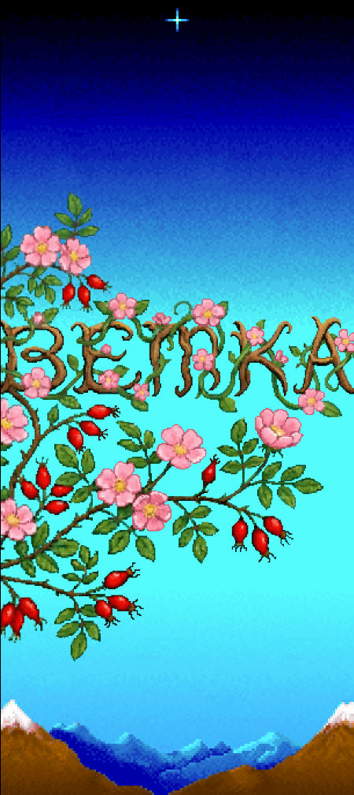
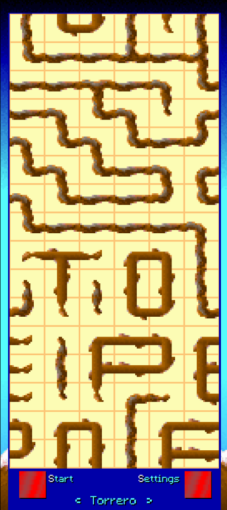
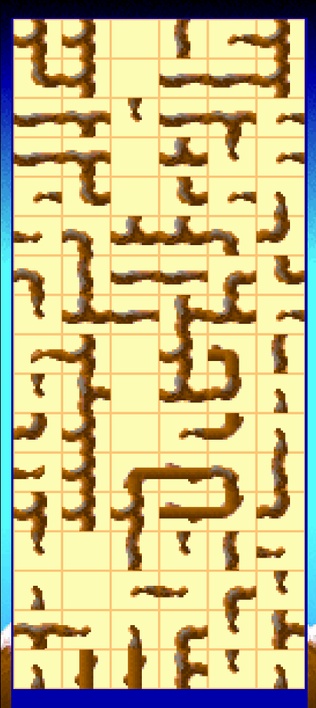
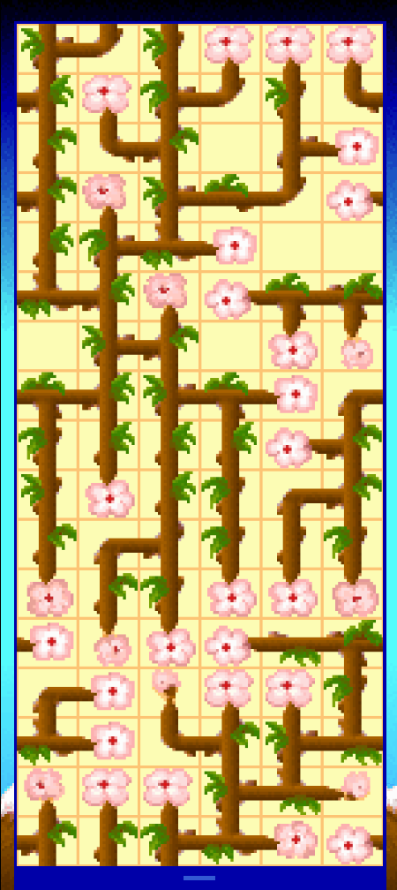

# Vetka 1992

A mobile recreation of **Ветка** (*Branch*, 1992), a Russian DOS abandonware puzzle game.

The original is long gone from everywhere except [Archive.org](https://archive.org/details/msdos_Vetka_1992), the developers were unreachable.

It's rebuilt from scratch in Godot 4.3 for Android, featuring hand-drawn pixel art animations, remade fonts, UI, some updated graphics, and a bunch of 2026 enhancements. Most of them can be toggled off.

---

## Screenshots

https://github.com/user-attachments/assets/bb650f16-e72f-4c7e-85d0-774405935840

<table>
  <tr>
	<td></td>
	<td></td>
	<td></td>
	<td></td>
  </tr>
</table>

## What is it?

Vetka is a relaxing tile-rotation puzzle game, similar to Pipe Dream / Pipe Fever. You have a grid of branch-shaped tiles, and your job is to rotate them so every bud on the grid connects back to the root to form one complete tree.

Having played it as a little kid, I was glued to the screen, spending hours and hours clicking on the branches to see them flower. I was SO sure I was making a sakura tree bloom, but it's actually a rose bush with the little rose hips! This game has some kind of a relaxing, zen vibe that other games in this genre are missing. 

Tap a tile to rotate it. That's pretty much it.

**Six difficulty levels** as the original, differing in grid size. On the hardest level, opposite edges of the grid wrap around, and the field becomes non-edged; making it a "torus".

---

## Status

> Version **1.0.0** — the game is complete and playable, so from here on it's new things on top.

## What's in it

- **Six difficulty levels**, with freshly grown boards every time
- **Hand-drawn pixel art animations:** tiles turn, buds open into flowers, and flowers ripen into fruit when you win
- **Three soundtracks of Bach and Beethoven**, plus an Off switch:
  - **Classic:** the original game's pieces, rebuilt from public-domain scores
  - **Modern:** my own renditions
  - **Midi New:** the same pieces on a sampled grand piano
- **English and Russian**
- **Give Up** that shows you the solution, and settings for animations and sound

---

## Download

Grab the latest signed APK from the [Releases](https://github.com/vurglepuddle/branch/releases) page and sideload it on your Android device.

*(Not on the Play Store)*

---

## Building from source

1. Install [Godot 4.3](https://godotengine.org/)
2. Clone this repo
3. Open the project in Godot
4. Export for Android (you'll need the Android export templates and your own keystore for signing)

Tests run headless: `GODOT=/path/to/godot tests/run_tests.sh`

---

## About the original

**Ветка** (*Vetka / Branch*) was released in 1992. It's a Pipe Dream variant developed in Russia. The goal is to connect each burgeon on the grid to the live branch by rotating tiles. This recreation is an unofficial fan project, all credit for the original concept goes to Gamos Ltd.

The original can be found on [Archive.org](https://archive.org/details/msdos_Vetka_1992).

---

## License

Code, scenes, shaders and project configuration are licensed under [GPL-3.0](LICENSE).

Original artwork, the VETKA font, Modern music, the rebuilt classical recordings and sound effects are licensed under [CC BY-NC-SA 4.0](LICENSE-ASSETS.txt), with credit to the project author optional. Commercial use of these assets requires separate permission; contact [vurglepuddle](https://github.com/vurglepuddle) through this repository.

The classical compositions are by **Johann Sebastian Bach** and **Ludwig van Beethoven**. The rebuilt piano recordings use **Salamander Grand Piano V3 by Alexander Holm (CC BY 3.0)**. See [credits and asset terms](CREDITS.md) and the [composition and score sources](MUSIC_SOURCES.md). The rebuilt MIDI and piano files are still being finalized and have not replaced the current classic tracks.

Made with [Godot Engine](https://godotengine.org/license) (MIT). The short version of all this is also in the game, under Settings > Credits.

This is an unofficial fan recreation, unaffiliated with the original developers.
